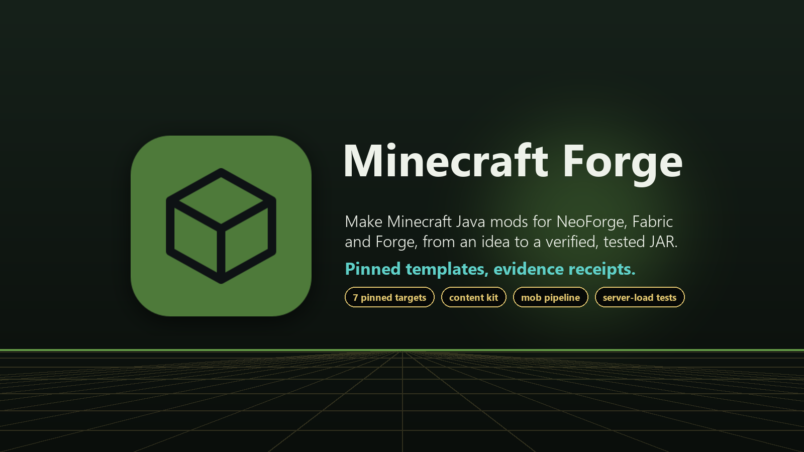
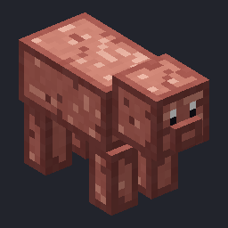
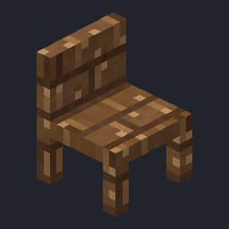
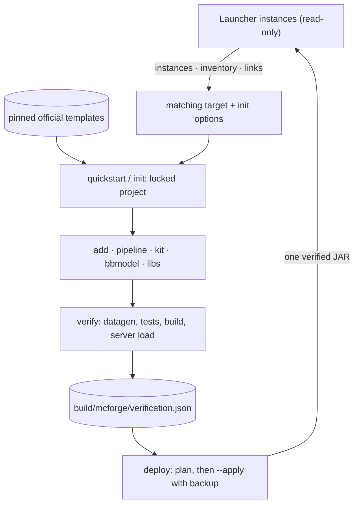

<div align="center">



[](https://github.com/SenjuWoo/Minecraft-Forge/actions/workflows/ci.yml)
[](https://github.com/SenjuWoo/Minecraft-Forge/releases/latest)
[](#install)
[](#bundled-targets)
[](LICENSE)

**[Install](#install)** · **[Tour](#a-short-tour)** · **[What you can make](#what-you-can-make)** · **[Commands](#commands)** · **[How it works](#how-it-works)** · **[Changelog](CHANGELOG.md)**

</div>

Minecraft Forge is a command-line workbench for making Minecraft Java mods with **NeoForge, Fabric and Forge**, built so an AI agent (or a person) can go from an idea to a verified, tested mod JAR. It scaffolds from pinned official templates, generates content in one command (blocks, items, food, tools, weapons, armor, furniture, mobs), imports and exports Blockbench models, paints free procedural art, adds popular libraries, makes resource/data/shader packs, deploys into launcher instances with backups, and writes an evidence receipt for every build.

It is an independent project, unaffiliated with the Minecraft Forge project, NeoForged, FabricMC or Mojang; the name describes a workbench. Made with ATLauncher in mind and works with Prism, MultiMC, CurseForge, the Modrinth App and the official launcher.

Point an agent at this folder and tell it to read **[AGENTS.md](AGENTS.md)**. Nothing is registered globally and no server keeps running.

## What you get

- **Seven pinned targets.** Official NeoForge, Fabric and Forge templates for 1.20.1, 1.21.1 and 26.3, pinned by hash and built and server-loaded in CI. Any other version resolves on demand with `--fetch`.
- **Content in one command.** `add` writes textures, models, blockstates, loot, lang and (on the four kit targets) the Java for blocks, items, food, tools, armor sets, furniture and mobs.
- **Character mobs from code.** `pipeline` generates a GeckoLib asset pipeline: rig, voxel model, painted texture with glow, animation clips, springs, look sheets and sound wiring, each step with its own validator.
- **Evidence, not claims.** `verify` builds, runs datagen and game tests, boots a headless server and writes a receipt that keeps compile, package, server load, client load and gameplay apart.
- **Installed reality first.** `instances`, `inventory` and `links` read launcher instances and installed mods read-only, and `links` predicts `NoSuchMethodError` / `AbstractMethodError` crashes between mods before you launch.
- **JSON everywhere.** Every metadata command prints JSON with stable exit codes (0 ok, 1 findings, 2 could not run). `capabilities` lists every command and option.


## Bundled targets

Every target is an official template pinned by hash, built and server-loaded in this repository's CI.

| Target | Loader | Minecraft | Java | Build system | Content kit (`add` writes Java) |
|---|---|---|---|---|---|
| `neoforge-1.21.1` (default) | NeoForge 21.1.265 | 1.21.1 | 21 | ModDevGradle 2.0.148 | yes |
| `neoforge-26.3` | NeoForge 26.3.0.103 | 26.3 | 25 | ModDevGradle 2.0.148 | assets + data |
| `fabric-1.20.1` | Fabric Loader 0.20.1 | 1.20.1 | 17 | Loom 1.19.4 | yes |
| `fabric-1.21.1` | Fabric Loader 0.20.1 | 1.21.1 | 21 | Loom 1.19.4 | yes |
| `fabric-26.3` | Fabric Loader 0.20.1 | 26.3 | 25 | Loom 1.19.4 | assets + data |
| `forge-1.20.1` | Forge 47.4.28 | 1.20.1 | 17 | ForgeGradle 6.0.54 | yes |
| `forge-26.3` | Forge 66.1.8 | 26.3 | 25 | ForgeGradle 7.0.40 | assets + data |

Any other version: `init ... --loader fabric --minecraft 1.19.2 --fetch` resolves that official template on demand (pinned by hash, clearly marked as not built by this release). Quilt packs load Fabric mods.

## Install

Requires Python 3.11+ and a JDK. The core toolkit uses only the standard library; the generated mob asset pipeline installs its own numpy and Pillow into a local virtual environment. The toolkit finds installed JDKs and can install a verified Temurin with `setup-java --major 8|17|21|25`.

```powershell
git clone https://github.com/SenjuWoo/Minecraft-Forge.git
cd Minecraft-Forge
.\Minecraft-Forge.ps1 doctor
```

On Linux/macOS use `python -m mcforge ...` from this folder.

`install` copies the toolkit to `%LOCALAPPDATA%\Minecraft-Tools\Minecraft-Forge` (or `~/.local/share/minecraft-forge`) with a launcher (`Minecraft-Forge.cmd` / `Minecraft-Forge`) that runs from any folder; relative paths mean the folder you run it in. Update with `install --force` from a newer copy: the previous install becomes a `Minecraft-Forge.bak-<time>` folder beside it (listed as `backups` in the result; delete the ones you no longer want) and its `local/` cache moves into the new install. To remove it, delete the install folder, its `.bak-*` siblings and, if no other copy uses them, `Minecraft-Tools\jdks`. Nothing else was changed on the machine.

First builds download Minecraft, the loader and libraries into `local/gradle/` and can take several minutes and gigabytes; later builds reuse them.

## A short tour

```powershell
.\Minecraft-Forge.ps1 instances                     # your launcher instances + the init options that match each
.\Minecraft-Forge.ps1 quickstart "D:\Mods\Ruby" --mod-id ruby --package dev.you.ruby --name "Ruby" --loader fabric --minecraft 1.21.1
.\Minecraft-Forge.ps1 add "D:\Mods\Ruby" toolset ruby --tier diamond
.\Minecraft-Forge.ps1 add "D:\Mods\Ruby" armor ruby --tier diamond
.\Minecraft-Forge.ps1 add "D:\Mods\Ruby" mob cave_boar --shape quadruped
.\Minecraft-Forge.ps1 add "D:\Mods\Ruby" furniture oak_chair
.\Minecraft-Forge.ps1 verify "D:\Mods\Ruby"         # build + headless game-test server + receipt
.\Minecraft-Forge.ps1 deploy "D:\Mods\Ruby" --instance "<instance folder>" --apply
```

The same steps on the default NeoForge 1.21.1 target, run for real. NeoForge before 1.21.5 needs the load test that `tests` adds; `quickstart` already wired it here, so `tests` reports it as configured:


`add` also renders what it made, without launching the game (`preview` does the same for any block model, `.bbmodel` or `.geo.json`):

<p align="center">
  
  
</p>

`pipeline` goes further for a character mob. The generated pipeline builds the example mob from code and checks each step:


Its look sheet, rendered by the pipeline from the generated model and texture:


## What you can make

| Want | Command | Guide |
|---|---|---|
| A mod for a loader and version | `quickstart` / `init --loader L --minecraft V` | `guide neoforge`, `guide fabric`, `guide forge` |
| Blocks, items, food | `add P block NAME`, `add P item NAME`, `add P food NAME` | `guide content` |
| Tools and weapons | `add P sword NAME`, `add P toolset NAME --tier diamond` | `guide content` |
| Armor sets (icons + worn layers) | `add P armor NAME --tier iron --repair ITEM` | `guide content` |
| Furniture (shaped, facing, collision) | `add P furniture NAME --shape chair\|table\|stool\|bench\|shelf\|cabinet\|lamp\|pedestal` | `guide content` |
| Mobs (entity, AI, model, renderer, spawn egg) | `add P mob NAME --shape quadruped\|biped\|blob [--hostile]` | `guide content` |
| A character mob: generated model, textures, animation, springs, sounds wiring (GeckoLib, NeoForge 1.21.1) | `pipeline P --mob NAME`, `kit P geomob --mob NAME`, `devshots P`, `devlog P` | `guide mobs`, `guide api` |
| Animated GeckoLib entities, secondary motion, custom AI | `libs --add geckolib --project P`, `kit P springs\|layer\|bonemath`, `model-check FILE`, `ground ANIM --geo GEO --legs ... --clips ...` | `guide entities` |
| Organic voxel models from shapes (no z-fighting) | `voxel SPEC.json --project P` | `guide entities` |
| A home in the world: home block that forms the mob, structures from code, lava and Nether anchoring, natural spawns | `kit P home --mob NAME`, pipeline `world`, `verify P --client --world normal` | `guide worldgen` |
| Scripted screenshots from a real client, recorded as evidence, and a gate over its log | `devshots P`, `verify P --client [--scenes a,b] [--world normal]`, `devlog P [--rules FILE]` | `guide testing` |
| Start from scratch (no example block/item) | `quickstart P ... --no-examples` | `guide testing` |
| Sounds, original SFX and voice lines | `audio-check P`, pipeline `audio export` / `audio --validate`, `verify P --client --scenes audio` | `guide audio` |
| Blockbench models in and out | `bbmodel P FILE --block ID` / `--entity ID`; furniture and mobs ship a `.bbmodel` | `guide content` |
| See a model without launching | `preview P FILE` (block model, `.bbmodel`, `.geo.json` posed and lit like the game, texture) | `guide content` |
| Popular libraries (GeckoLib, Curios, Architectury, JEI, Cloth Config, ~70) | `libs`, `libs --add SLUG --project P` | `guide libraries` |
| Resource, data and shader packs | `pack PATH --kind resource\|data\|shader` | `guide packs` |
| Match and deploy to a launcher instance | `instances`, `inventory`, `links`, `deploy` | `guide launchers` |
| Find broken references between installed mods after an update | `links --instance PATH` / `inventory --instance PATH --links` | `guide launchers` |
| Route a request before writing anything | `plan "a fabric 1.20.1 mod with a boar mob"` | |

Generated art is original and procedural (standard-library PNG writer): no downloads, accounts or paid services. Replace it with your own when the feature is final; the Blockbench projects make that a round trip.

## Commands

`doctor` `targets` `instances` `inventory` `links` `jar` `init` `quickstart` `add` `asset` `bbmodel` `preview` `model-check` `voxel` `ground` `audio-check` `devshots` `devlog` `kit` `pipeline` `tests` `libs` `pack` `plan` `capabilities` `gradle` `verify` `deploy` `sources` `search` `updates` `setup-java` `install` `self-test` `guide`.

`capabilities` prints all of them with every option as JSON. Every metadata command emits JSON and a stable exit code: 0 success, 1 the command ran and found problems (`doctor` not ready, `model-check` z-fighting, `audio-check` or `devlog` problems, `jar`/`inventory` errors, `links` broken references between mods), 2 the command could not run (one JSON `{"error": ...}` line on stderr). Gradle output goes to a log under `PROJECT/build/mcforge/logs/` with a bounded failure tail on stderr; `MCFORGE_INFO=off` hides progress lines.

Guides ship with the tool, one at a time: `guide workflow|neoforge|fabric|forge|content|entities|mobs|worldgen|api|assets|audio|libraries|launchers|packs|tools|testing` (the same files are in [docs/](docs/)).

## How it works



`verify` hashes the project's inputs, runs datagen/tests/build, inspects the JAR and writes a receipt (`build/mcforge/verification.json`) with separate tiers: **compile, package, server load, client load, gameplay**. The first three run headlessly; `client_load` is recorded by `verify --client` (a generated screenshot run, NeoForge 1.21.1) and `gameplay` stays `not_run` until someone plays. `verify --check` rehashes the receipt offline. Fabric projects ship Fabric's official game-test wiring and a load test; NeoForge before 1.21.5 (including 1.21.1) gets one with `tests P`; the other targets use `verify --load`.

Project targets are locked (game, loader, Java, Gradle distribution and checksum, wrapper hash, plugin, mappings). Builds refuse drift; `updates P` reports official candidates without changing anything.

## Scope and limits

- **Never modifies** launcher instances, installed mods, configs, worlds or launcher settings, except `deploy --apply`, which copies one verified JAR and backs up what it replaces. No global Java, PATH or registry changes.
- **Verified in CI:** Python 3.11/3.14 on Windows and Linux; all seven targets scaffold, build and boot a headless server; every content kind compiles and loads on the four kit targets; the portable package is rebuilt and exercised.
- **Not claimed:** client rendering, multiplayer, save upgrades, arbitrary modpack compatibility or automatic crash repair. Shader packs are not compiled by the toolkit. Content Java for 26.x targets is not generated yet (assets and data are).

## Development checks

```powershell
python -m mcforge self-test
python scripts/package.py
python scripts/verify_package.py
```

See [CHANGELOG](CHANGELOG.md), [roadmap](docs/ROADMAP.md), [contributing](CONTRIBUTING.md), [code of conduct](CODE_OF_CONDUCT.md), [security](SECURITY.md) and [third-party notices](THIRD-PARTY.md). MIT licence, see [LICENSE](LICENSE).
